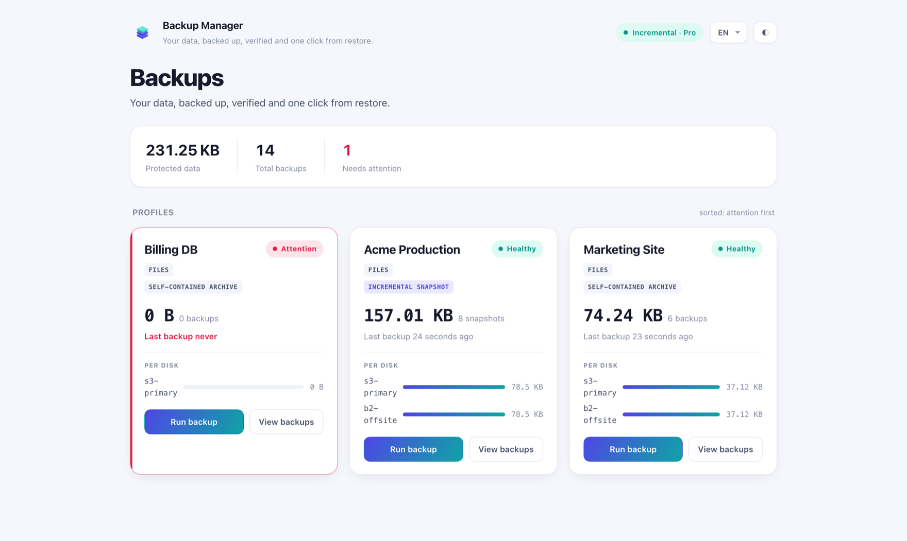

# Pro & the UI dashboard

Backup Manager is **open-core**: the free `nyoncode/laravel-backup-manager`
package is a complete, CLI-first backup tool on its own. **Pro** and the **UI
dashboard** are commercial add-ons that plug in through the core's existing
contracts — installing them upgrades the same commands and managers, with no
code changes on your side.

If a feature below is marked **Pro**, the free core keeps the contract but fails
closed without the Pro package: it never silently produces a backup that is less
protected than you asked for.

## What's in each tier

| Capability | Free core | Pro |
| --- | :---: | :---: |
| Database + file backups, compression, AES-256 encryption | ✅ | ✅ |
| Integrity manifest + checksums | ✅ | ✅ |
| Multi-destination storage (any Laravel disk) | ✅ | ✅ |
| Restore with verify + rollback | ✅ | ✅ |
| Scheduling & queues | ✅ | ✅ |
| Retention: `simple` (keep-latest, age, count) | ✅ | ✅ |
| Mail notifications | ✅ | ✅ |
| **Incremental & deduplicated backups** | — | ✅ |
| **GFS retention** + total-size cap | — | ✅ |
| **HMAC manifest signing** (tamper-evidence) | — | ✅ |
| **Health monitoring** (`backup:monitor`) + history | — | ✅ |
| **Slack notifications** | — | ✅ |

The free core can *read and list* snapshots produced by Pro, but not create,
restore or verify them; requesting a Pro strategy (e.g. `retention.strategy =
gfs`) without Pro prunes nothing rather than doing the wrong thing.

## Upgrading to Pro

Pro is distributed from NyonCode.cz's Composer repository to licence holders. The
core ships a command that wires everything up from your licence key:

```bash
php artisan backup:upgrade <licence-key>
```

It points Composer at the repository, stores the key as the HTTP-basic password
and requires `nyoncode/laravel-backup-manager-pro`. The Pro service provider then
overrides the core's null bindings with the real snapshot driver, GFS strategy,
signer, monitor and Slack channel — the `backup:*` commands gain the features
above on the next run.

The **Backup Manager Pro** package documents its full feature list and roadmap.

## The UI dashboard

**Backup Manager UI** is a live Livewire dashboard for your backups — run,
browse, restore, verify and monitor every destination from one screen. It builds
on Pro (health monitoring, history and incremental snapshots), so it **requires
Pro**; there is no free-core build.



Highlights:

- **Fleet health at a glance** — every profile and destination, sorted
  attention-first, with per-disk size bars and a last-runs strip.
- **One-click, safe actions** — run, verify and restore live; restores are
  rollback-safe and checksum-verified, exactly like the CLI.
- **Safe by default** — restore and retention are off until you enable them and
  are re-checked server-side, never merely hidden.
- **Multilingual** — English, Deutsch and Čeština, with an in-page switcher that
  never touches your app's own locale.

Install it after Pro (it pulls Pro and the core in automatically):

```bash
composer require nyoncode/laravel-backup-manager-ui
```

It mounts at `/backup-manager`. The **Backup Manager UI** package documents the
full setup, configuration and safety model.
