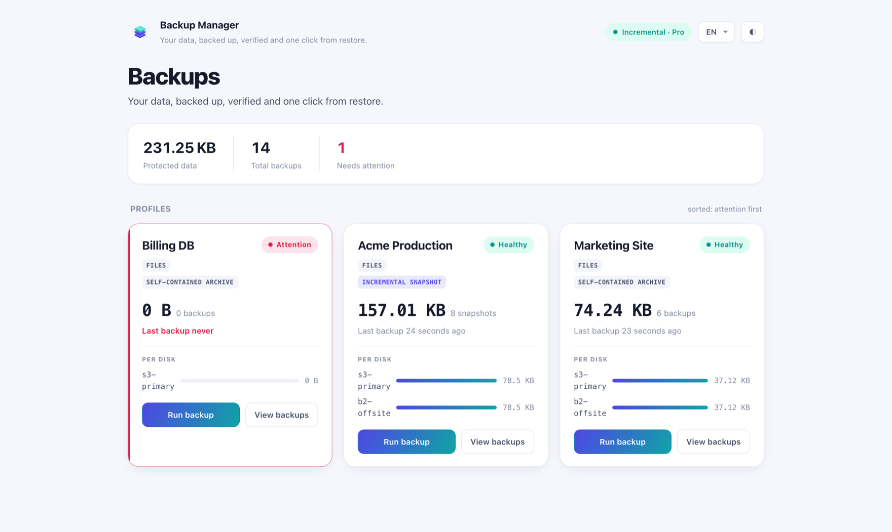

# Pro a UI dashboard

Backup Manager je **open-core**: free balíček `nyoncode/laravel-backup-manager`
je sám o sobě kompletní zálohovací nástroj s CLI. **Pro** a **UI dashboard** jsou
komerční doplňky, které se zapojují přes existující kontrakty jádra — jejich
instalace jen povýší stejné příkazy a managery, bez jakýchkoli zásahů do vašeho
kódu.

Pokud je funkce níže označená **Pro**, free jádro si ponechá kontrakt, ale bez
Pro balíčku selže „fail-closed": nikdy potichu nevytvoří zálohu méně chráněnou,
než jste chtěli.

## Co je v které úrovni

| Schopnost | Free jádro | Pro |
| --- | :---: | :---: |
| Zálohy databází a souborů, komprese, šifrování AES-256 | ✅ | ✅ |
| Integritní manifest + kontrolní součty | ✅ | ✅ |
| Ukládání na více cílů (libovolný Laravel disk) | ✅ | ✅ |
| Obnova s ověřením + rollbackem | ✅ | ✅ |
| Plánování a fronty | ✅ | ✅ |
| Retence: `simple` (drž nejnovější, stáří, počet) | ✅ | ✅ |
| Mailové notifikace | ✅ | ✅ |
| **Inkrementální a deduplikované zálohy** | — | ✅ |
| **GFS retence** + strop celkové velikosti | — | ✅ |
| **HMAC podpis manifestu** (průkaznost neporušenosti) | — | ✅ |
| **Monitoring zdraví** (`backup:monitor`) + historie | — | ✅ |
| **Slack notifikace** | — | ✅ |

Free jádro umí snapshoty vytvořené Pro *číst a vypsat*, ale ne vytvořit, obnovit
ani ověřit; požadavek na Pro strategii (např. `retention.strategy = gfs`) bez Pro
raději nesmaže nic, než aby udělal špatnou věc.

## Přechod na Pro

Pro se distribuuje z Composer repozitáře NyonCode.cz držitelům licence. Jádro
obsahuje příkaz, který vše nastaví z vašeho licenčního klíče:

```bash
php artisan backup:upgrade <licencni-klic>
```

Nasměruje Composer na repozitář, uloží klíč jako HTTP-basic heslo a nainstaluje
`nyoncode/laravel-backup-manager-pro`. Pro service provider pak přepíše null bindingy
jádra reálným snapshot driverem, GFS strategií, signerem, monitorem a Slack
kanálem — příkazy `backup:*` získají výše uvedené funkce při dalším běhu.

Kompletní seznam funkcí a roadmapu najdete u balíčku **Backup Manager Pro**.

## UI dashboard

**Backup Manager UI** je živý Livewire dashboard pro vaše zálohy — spouštění,
procházení, obnova, ověření a monitoring každého cíle z jedné obrazovky. Staví na
Pro (monitoring zdraví, historie a inkrementální snapshoty), takže **vyžaduje
Pro**; verze pro samotné free jádro neexistuje.



Nejdůležitější:

- **Zdraví celého parku na první pohled** — každý profil a cíl, seřazené „co
  potřebuje pozornost první", s pruhy velikostí podle disků a stripem posledních
  běhů.
- **Bezpečné akce na jedno kliknutí** — spuštění, ověření i obnova živě; obnovy
  jsou rollback-safe a ověřené kontrolním součtem, přesně jako v CLI.
- **Bezpečné ve výchozím stavu** — obnova a retence jsou vypnuté, dokud je
  nezapnete, a kontrolují se na serveru, ne jen skryté.
- **Vícejazyčné** — angličtina, němčina a čeština s přepínačem přímo na stránce,
  který nikdy nesáhne na jazyk vaší aplikace.

Instalace po Pro (Pro i jádro si přitáhne automaticky):

```bash
composer require nyoncode/laravel-backup-manager-ui
```

Připojí se na `/backup-manager`. Kompletní nastavení, konfiguraci a bezpečnostní
model najdete u balíčku **Backup Manager UI**.
