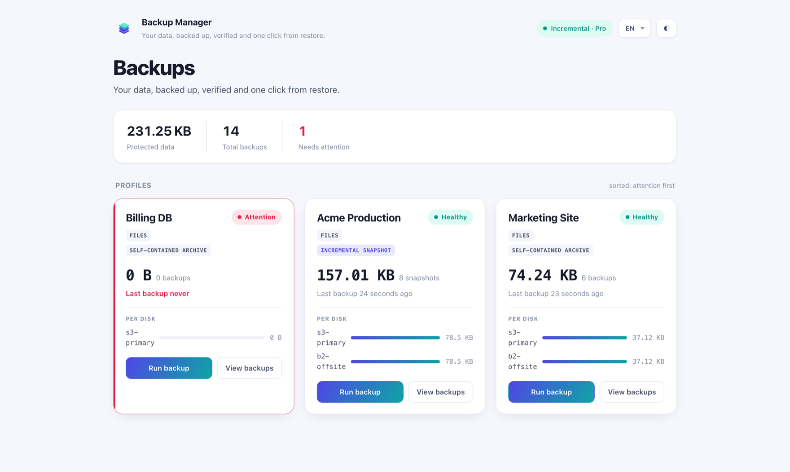

# Pro a UI dashboard

Backup Manager je **open-core**: free balíček `nyoncode/laravel-backup-manager`
je sám o sobě kompletní zálohovací nástroj s CLI. **Pro** a **UI dashboard** jsou
komerční doplňky, které se zapojují přes existující kontrakty jádra — jejich
instalace jen povýší stejné příkazy a managery, bez jakýchkoli zásahů do vašeho
kódu.

Pokud je funkce níže označená **Pro**, free jádro si ponechá kontrakt, ale bez
Pro balíčku selže „fail-closed": nikdy potichu nevytvoří zálohu méně chráněnou,
než jste chtěli.

## Co je v které úrovni

| Schopnost | Free jádro | Pro |
| --- | :---: | :---: |
| Zálohy databází a souborů, komprese, šifrování AES-256 | ✅ | ✅ |
| Integritní manifest + kontrolní součty | ✅ | ✅ |
| Ukládání na více cílů (libovolný Laravel disk) | ✅ | ✅ |
| Obnova s ověřením + rollbackem | ✅ | ✅ |
| Plánování a fronty | ✅ | ✅ |
| Retence: `simple` (drž nejnovější, stáří, počet) | ✅ | ✅ |
| Mailové notifikace | ✅ | ✅ |
| **Inkrementální a deduplikované zálohy** | — | ✅ |
| **GFS retence** + strop celkové velikosti | — | ✅ |
| **HMAC podpis manifestu** (průkaznost neporušenosti) | — | ✅ |
| **Monitoring zdraví** (`backup:monitor`) + historie | — | ✅ |
| **Slack notifikace** | — | ✅ |

Free jádro umí snapshoty vytvořené Pro *číst a vypsat*, ale ne vytvořit, obnovit
ani ověřit; požadavek na Pro strategii (např. `retention.strategy = gfs`) bez Pro
raději nesmaže nic, než aby udělal špatnou věc.

## Přechod na Pro

Pro se distribuuje z Composer repozitáře NyonCode.cz držitelům licence. Jádro
obsahuje příkaz, který vše nastaví z vašeho licenčního klíče:

```bash
php artisan backup:upgrade
```

Spusťte ho bez argumentu a zeptá se na klíč (skrytý vstup). V automatizaci
nastavte místo toho `BACKUP_PRO_TOKEN`:

```bash
BACKUP_PRO_TOKEN=<licencni-klic> php artisan backup:upgrade
```

> Vyhněte se `php artisan backup:upgrade <licencni-klic>`. Stále funguje, ale klíč
> skončí v historii shellu a ostatní lokální uživatelé ho uvidí v `ps`. Příkaz vás
> na to upozorní.

Adresa repozitáře na prostém `http` se odmítne, protože se klíč posílá jako
HTTP-basic přihlašovací údaje (výjimkou je jen `localhost`).

Nasměruje Composer na repozitář, uloží klíč jako HTTP-basic heslo a nainstaluje
`nyoncode/laravel-backup-manager-pro`. Pro service provider pak přepíše null bindingy
jádra reálným snapshot driverem, GFS strategií, signerem, monitorem a Slack
kanálem — příkazy `backup:*` získají výše uvedené funkce při dalším běhu.

Kompletní seznam funkcí a roadmapu najdete u balíčku **Backup Manager Pro**.

## UI dashboard

**Backup Manager UI** je živý Livewire dashboard pro vaše zálohy — spouštění,
procházení, obnova, ověření a monitoring každého cíle z jedné obrazovky. Staví na
Pro (monitoring zdraví, historie a inkrementální snapshoty), takže **vyžaduje
Pro**; verze pro samotné free jádro neexistuje.



Nejdůležitější:

- **Zdraví celého parku na první pohled** — každý profil a cíl, seřazené „co
  potřebuje pozornost první", s pruhy velikostí podle disků a stripem posledních
  běhů.
- **Čerstvost podle profilu** — pruh ukazuje, kolik z povoleného stáří profil
  spotřeboval, podle jeho plánu: „Očekáváno každých 14 dní · další běh za 3 dny",
  „Právě na řadě — čeká se na zálohu", když je běh opožděný, a „Po termínu o
  2 dny na s3", když je nejnovější záloha na disku za prahem. Prahy jsou stejné, jaké používá
  `backup:monitor` (viz [Plánování](10-planovani.md)).
- **Mobilní zobrazení** — na úzkých displejích se tabulky změní na karty.
- **Bezpečné akce na jedno kliknutí** — spuštění, ověření i obnova živě; obnovy
  jsou rollback-safe a ověřené kontrolním součtem, přesně jako v CLI.
- **Bezpečné ve výchozím stavu** — obnova a retence jsou vypnuté, dokud je
  nezapnete, a kontrolují se na serveru, ne jen skryté.
- **Vícejazyčné** — angličtina, němčina a čeština s přepínačem přímo na stránce,
  který nikdy nesáhne na jazyk vaší aplikace.

Instalace po Pro (Pro i jádro si přitáhne automaticky):

```bash
composer require nyoncode/laravel-backup-manager-ui
```

Připojí se na `/backup-manager`. Kompletní nastavení, konfiguraci a bezpečnostní
model najdete u balíčku **Backup Manager UI**.

### Uvnitř WireStack adminu

S nainstalovaným `nyoncode/wire-core` 2.x se dashboard připojí do panelu WireStack 2
(wire-admin) bez jakéhokoli lepicího kódu. Připojte ho pod prefix a guard adminu:

```dotenv
BACKUP_UI_PATH=admin/backups
```

```php
// config/backup-manager-ui.php
'middleware' => ['web', 'auth', 'can:backups.manage'],

'wirestack' => [
    'ability' => 'backups.manage',   // kdo uvidí položku v menu
],
```

Pak:

- Do postranního menu přibude položka **Backups** (podpoložky Overview, Activity,
  Settings) přes hook `navigation.building` z wire-core.
- Obrazovky se vykreslí uvnitř layoutu hostitele (`layouts.admin`, který zapíše
  `php artisan wire-admin:install`) a přejmou jeho vzhled.
- Položka nese **červený odznak** s počtem profilů, které potřebují pozornost, tak
  jak je dashboard naposledy viděl. Čte se jen z cache — menu nikdy nespustí
  kontrolu zdraví.

`wirestack.ability` jen skrývá položku v menu; skutečným strážcem jsou
`middleware` rout. Bez ní položku vidí každý přihlášený uživatel.

Všechny klíče jsou pod `backup-manager-ui.wirestack`:

| Klíč | Výchozí | Význam |
| --- | --- | --- |
| `enabled` | `'auto'` (`BACKUP_UI_WIRESTACK`) | `'auto'` zapne, když je WireStack nainstalovaný; `true` / `false` vynutí |
| `layout` | `'layouts.admin'` | komponenta layoutu hostitele (ignoruje se, je-li nastaven `layout` níže) |
| `key` | `'backups'` | klíč, pod kterým je položka vedena |
| `label` | `null` | popisek; `null` je přeložené „Backups" |
| `icon` | `'outline:archive-box'` | ikona |
| `group` | `null` | klíč navigační skupiny, např. `'system'` |
| `sort` | `90` | pořadí v menu |
| `children` | `true` | zobrazit pod položkou Overview / Activity / Settings |
| `ability` | `null` | Gate ability, která položku zobrazí |
| `badge` | `true` | zobrazit odznak pozornosti |

### Libovolný layout hostitele

Nejste na WireStacku? Vykreslete dashboard v libovolné layout komponentě své
aplikace:

```dotenv
BACKUP_UI_LAYOUT=layouts.admin
```

(nebo `'layout' => 'layouts.admin'` v `config/backup-manager-ui.php`). Dashboard
zahodí vlastní hlavičku a přejme vzhled hostitele. Název, který se nepodaří
přeložit na komponentu, se vrátí k samostatnému dashboardu místo chyby.
